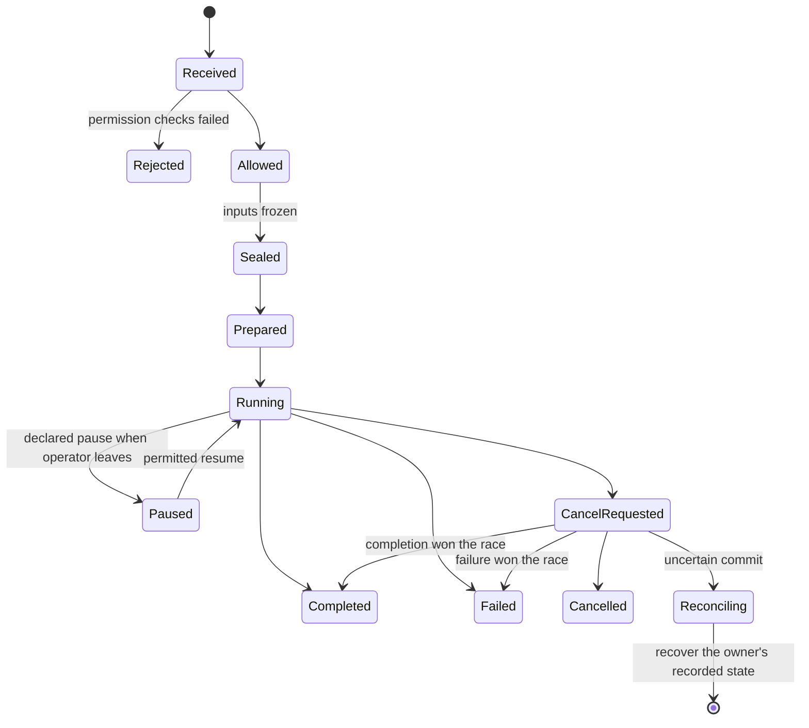

<a id="target&#45;rebuild&#45;product&#45;contract"></a>

Use this contract to design the fresh RawFish rebuild: one cockpit, three lanes, explicit model choice and evidence\-linked reports\. It describes intended behavior, not a working replacement\. For the current prototype, start with [using RawFish](/rawfish/using) or [its architecture](/rawfish/architecture)\.

Features outside the target remain absent until their behavior is defined and implemented; disabled placeholders do not make them available\.

## Target product surface {#target-product-surface}

RawFish has two browser routes:

- `/`, Launch;
- `/run/:runId?`, the cockpit, for a draft or a saved run\.

Everything else about a run is state within the cockpit: `step=` selects Scenario, Build, Cohorts, Preflight, Simulate or Findings, and `mode=read|ask|data` selects the Findings modes, with `data` shown as Analysis\. Report, chat, compare and sensitivity are cockpit states, not routes\. Unknown query values and keys are rejected rather than guessed at, and a link never carries scenario text, source material, credentials or configuration\. Share copies a link to a saved run and its current step, and grants nothing by itself\.

Lane ids are `creator`, `internal_policy` and `public_policy`\. Backend lane traffic flows through `/api/sim/use-cases/<lane_id>/...`\.

## Target lane catalog {#target-lane-catalog}

Every registered lane returns a catalog with a required, nested `lane_manifest`\. The manifest publishes the lane's cockpit slots, scenario fields, cohort pack, connector capabilities, evaluation ids, report sections, caveats and the reference to its statistical manifest\. The statistical manifest is the only list of the lane's statistical controls; a control that does not apply to a lane is omitted\. Pasted text is the only admitted source\.

## Target provider router {#target-provider-router}

RawFish supports three provider modes:

- `local_ollama`
- `local_openai_compatible`
- `external`

Local modes do not require external provider credentials\. The first working route is local Ollama\. External mode requires an explicit provider, model and key selected when launching that run; it is never an automatic fallback\. The preflight meter returns the scale cap, token estimate, provider readiness, model id, latency and, in external mode, the cost estimate, or `cost_unavailable` when the price is unknown\. The provider chosen for a run is kept with it and used for its report\.

## Target report posture {#target-report-posture}

Reports describe simulated responses and hypotheses\. Forecasting real\-world outcomes requires empirical validation of the claim; generated personas are not a sample of a real population\. Every claim carries one of five labels \(simulated observation, inference, grounded in source, assumption, needs validation\) and must point to evidence of a kind its label allows, or it is demoted to \"needs validation\"\. Every report passes the language guard before it is kept and again whenever it is read; the guard proves only that its lexical rules ran\. Every report states that its content was generated by AI personas in a simulation and is not attributable to any real person\. What blocks and what only advises is in [guardrails](/rawfish/guardrails)\.

## Target workbench {#target-workbench}

Statistical changes go through guarded JSON Patch requests that carry the settings hash the client last read and an idempotency key\. Save stores a new revision before the run starts; Save and re\-seed forks a new variant run and never changes the base run\. Variants, their lineage and the comparison between a base run and a variant are kept as records of their own, and the run's metadata keeps the provider, preflight and statistical state its report was generated from\.

## Current proof\-of\-concept departures {#current-proof-of-concept-departures}

When reusing examples from this prototype, account for these differences:

- Launch exposes `paste`, `cached`, `live` and `graph` source markers, and the backend admits all four names in `source_context`, while the target below admits pasted text only\. The markers do not establish working admitted connectors for the other modes\.
- The backend retains both the generic comparison endpoint and `/<use_case_id>/simulation/<sim_id>/statistical-config/compare`; the target has one generic comparison surface\.
- The cockpit is not fully manifest\-only: Launch branches on lane id for presets and parser identity, and the run store branches for parser identity, creator\-versus\-policy scenario payloads and the two policy stakeholder fallbacks\. A genuinely distinct new lane therefore needs cockpit work and tests in this tree; the target removes those lane\-id branches\.
- The creator runner writes a deterministic completion marker instead of executing an agent swarm\. Its report generator consumes the scenario and segment identities/types, not the evidence catalog or the workbench's cohort statistical settings\. Its report can use a real model without becoming evidence of agent interactions or the effect of those settings\.
- The current **Reseed variant** control updates the same pre\-start run and appends a settings lineage snapshot\. It does not fork a separately executable run\. The comparison endpoint compares those settings, then reports findings\-subject presence without reading and validating both reports\. The displayed findings buckets are not a report comparison\.
- The cockpit supplies an expected hash for **Save patch**, but the backend accepts patches without it\. The seed\-only reseed path does not require an expected hash either\. Both routes reject `starting`, `running`, `completed` and `reported` phases, but omit `failed` from that phase check\. The cockpit freezes failed runs too; the API's failed\-run mutation gap remains\.
- Report JSON reads validate the adapter schema without rechecking the language guard, recorded digest or embedded run identity\. Report JSON, Markdown and metadata are separate writes; a readable JSON file can survive a later publication failure\.

Use the target sections above for the rebuild's requirements\. The [prototype architecture](/rawfish/architecture) follows its current calls and stored results\. Keep the two versions separate when testing or explaining them\.

## Target verification {#target-verification}

- The cockpit's lifecycle calls go through the generic lane API\.
- Run\-bound routes load lane, provider, graph, report and workbench state from stored run records\.
- Statistical manifests are populated and validated\.
- Local and external report generation use the same stored provider configuration\.
- Preflight probes the selected provider when asked and reports an external budget status\.
- The two policy lanes use their own adapters over shared policy\-core helpers\.

`make ci` runs the prototype's complete local check\. [Check a change](/rawfish/runbook#maintainer-qualification) lists the tests it runs\. The rebuild must be tested against its own requirements\.

## Run ownership and transitions {#run-ownership-and-transitions}

These requirements describe the rebuild, not the Flask prototype\. The Rust SDK is the common implementation for the standalone application, an embedded host and an optional service\. Pale links it as a normal crate dependency, without a RawFish source submodule\. Thin Python and TypeScript SDKs expose the same operations\.

The run operations check and record each transition\. An accepted request creates one run identity\. Execution and cancellation check that run's current generation and revision, and retries recover its recorded result\. A generation distinguishes a new preparation of the run from an earlier attempt; the revision identifies the state a particular change expects\.

The lifecycle below describes the intended behaviour; the protocol's exact state names remain to be defined\.



**Accepting the request\.** A rejected request produces a denial record, without an executable run or use of a source\. An accepted request records one run identity with the request's retry key, principal, data controller, optional relationship scope, purpose, instance, generation and expected revision\. Repeating the same request returns its existing result\. Reusing its key with a changed body, or asking to change a stale revision, must fail\.

**Fixing the inputs\.** RawFish freezes the lane manifest, source bundle, packs, scenario, cohorts, statistical settings, provider and runner profiles, permissions, budgets and source revisions together\. Changing the lane or any of those inputs requires a new generation or run, which passes the same checks\.

**Preparing and starting\.** Preparation checks that the chosen provider, runner and resources can use those fixed inputs\. Running begins only when the checked run operations record the execution attempt with the owner: the embedded host or RawFish's standalone/service application\. A ready\-looking interface, live process or allocated worker alone cannot establish either state\. The host supplies the transaction and storage in embedded mode\. Before recovery, match provider output and report references to the run, generation, execution attempt and fixed inputs\. Read their recorded digests and the owner’s committed state; reject output from a different or superseded attempt\.

**Finishing or cancelling\.** The operations check the exact run, generation and revision before its owner commits a terminal state with the artifact, finding and result references\. The owner then supplies that record for read\-back\. Cancellation can lose a race to completion or failure; its reply must report the state that actually committed\. Exercise completion and failure winning the cancellation race, duplicate cancellation and late provider output\. Only the terminal result committed for this run generation may enter accepted history\.

An uncertain commit can require recovery at any step; the diagram draws it once\. Recovery reads the owner's record to determine whether the change committed\. It never creates a second run to resolve that uncertainty\.

The simulation's terminal result, a caller's acceptance, an outside effect, delivery of an event, settlement and the eventual real\-world outcome each need their own record and responsible owner\. For example, finishing a simulation can produce a deliverable for Weave without establishing that Weave accepted it or that anyone acted on it\.

| Mode | Who keeps the work and storage | How the result is recorded |
| --- | --- | --- |
| Standalone | RawFish's application owns the run and store\. | Its checked operations record execution, findings, cancellation and the terminal result\. It works without Pale, a host or another service\. |
| Embedded crate | The host owns the work, transaction and run storage\. | The host calls RawFish's Rust SDK and records results through the agreed operation and storage interfaces\. RawFish supplies the simulation behaviour without a parallel store\. The host records its own acceptance separately\. |
| Remote service | The caller owns its operation; RawFish owns a separately identified simulation run\. | Each keeps its own commit and recovery record\. Delivery, completion of the simulation and the caller's acceptance are recorded separately\. |

Every request names the caller, principal, data controller, relationship scope where applicable, purpose and request identity\. Run references include the instance, generation and expected revision\. The invocation contract establishes who may write each record\. Displaying a cockpit in a plugin or iframe, or delivering a message, supplies no additional permission\. A host's surrounding work also remains distinct from the simulation's inputs and results\.

People use the same cockpit journey, run states, claim labels and unavailable states in every mode\. A host follows the shared world and module design without changing what a control or result means\. Linking the Rust crate provides embedded operation\. Running a child process over an authenticated local socket provides a local service, which needs its own installation, supervision and recovery checks; access to its socket alone grants no permission to operate it\. Removing either connection preserves the owners' existing records and independent operation\.

A deployment may also choose an event outbox\. The run change and its outgoing event are written in the same database transaction, allowing delivery to be retried without inventing another run change\. Events sent to Pale's history contain only permitted identifiers, transitions and result references, with no source text or credentials\. Standalone RawFish works without this outbox\. Receiving an event establishes delivery; the named owner still supplies the underlying result, acceptance or outside\-effect record\.

### Planned Pale operations {#planned-pale-operations}

These operation names are proposed interfaces; none is implemented yet\.

| Capability | RawFish's responsibility |
| --- | --- |
| `product.rawfish.run.start.v1` | Validate one request, create its run and return a run reference and receipt\. |
| `product.rawfish.run.observe.v1` | Return permitted lifecycle, artifact, evaluation and terminal references within the request's limits, without exporting the run store\. |
| `product.rawfish.run.cancel.v1` | Check the run's generation and revision, then return a durable cancellation acknowledgement or the terminal result\. |
| `product.rawfish.connector.acquire.v1` | Own the connector contract, parser, normaliser and resulting source artifact\. A provider adapter performs only the declared acquisition, with the acquisition actor, legal entity, data controller, rights holders, source authorities, artifact issuer and custodian evidenced separately\. Principal, controller and optional relationship scopes are isolation keys and do not prove those roles\. |

## Cockpit state and navigation {#cockpit-state-and-navigation}

The visible phase words are draft, prepared, running, paused, halted, complete and reported\. Failed and Cancelled map to halted with their recorded reason\. Rejected stays in draft with its reason\. Reconciling is a separate label and blocks edits until the owner's state is recovered\. A cancellation request is pending until its committed result is known\. A halted run offers only its record until a recovery contract exists: no Stop, resume or restart control\. A run paused because the operator left under its declared pause policy shows no running light, explains that cause and offers Resume through the pause operation\.

An evidence link and its sheet header use the same narrowest applicable scope, for example “3 of 41 acts in round 5 cite this”\. The web host records every overlay level in browser history so Back undoes one level\. Embedded hosts use the same typed identifiers in their own navigation\. Identifiers such as `claim:c-03/acts` and `node:n-18` do not require one fragment mechanism across hosts\. Links carry identifiers, not draft contents or permission\.

Findings shows Read, Ask and Analysis in its heading's mode switch with the current mode visible\. Download report is Read's primary action\. Analysis includes one\-at\-a\-time sensitivity only when a real rerun/evaluation supports it; a surrogate explanation cannot establish sensitivity or causation\.

Preflight shows a token range with its basis, for example “350,000–470,000 tokens · 212 agents × 16 rounds at this model's last measured rate”\. These are illustrative values, not measured RawFish results\. Until a rate has been measured it shows “No estimate yet”; an unknown provider price remains unavailable\. Enforced budgets are independent of that estimate\.

## Cockpit capability placement {#cockpit-capability-placement}

This table gives the rebuild's 47 intended placements\. It does not advertise existing endpoints\. A control appears only after its operation, permitted inputs and result checks work\. Zep references identify the source mechanism; the graph\-store choice waits for a measured local run\.

| Capability | Place and expected behaviour |
| --- | --- |
| Ontology generation | Build's ontology panel\. |
| Graph retrieval and construction | Build progress and the world stage; the current board names Zep\. |
| Streaming persona preparation | Cohorts' sampling stream\. |
| Time model and behaviour | Cohort priors and Preflight's clock\. |
| Dual\-platform swarm | Simulate's stage and timeline\. |
| Posts and acts feed | Evidence sheet, filtered to its caller\. |
| Report agent tool use | Findings read mode, with tool activity in the console\. |
| Agent and report chat | Findings ask mode\. |
| Agent statistics | Findings data distributions\. |
| Run history and replay | Launch's run index and Simulate's round scrubber\. |
| `listPersonas` | Scenario's cohort\-plan catalogue\. |
| `listPresets` and `getPreset` | Launch's preset rail\. |
| `previewScenario` | Launch's scenario preview\. |
| `parseScenario` | Scenario's draft and source chip\. |
| `validateScenario` | Scenario's readiness indicators\. |
| `validatePriors` | Cohorts' inline field path, message and code\. |
| `uploadPriors` | Cohorts' prior attachment and hash, once a working connector is admitted\. |
| `createSimulation` | Preflight's create operation\. |
| `prepareSimulation` | Preflight's prepare operation\. |
| `startSimulation` | Preflight's launch action and token estimate\. |
| `stopSimulation` | Simulate's retry\-safe cancellation, once implemented\. |
| `getSimulationStatus` | Console status and the step navigation's phase\. |
| `generateSimulationReport` | Findings read mode's generation progress; only committed, checked reports may be read\. |
| `getSimulationReport` | Findings read mode's claim cards\. |
| `report.md` | Findings read mode's download beside its provenance\. |
| `compareSimulations` | Findings data mode's three\-bucket comparison\. |
| `createCounterfactual` | Findings data mode's new draft, returning to preparation through its own contract\. |
| `runSurrogateExplainer` | Findings data mode's bounded explanatory sweep\. |
| `getSurrogateExplainer` | Findings data mode's tornado chart and method qualification\. |
| `getClaimDrivers` | Findings read mode's claim\-driver explanation\. |
| Ensemble runner | Findings data mode's ensemble panel and interquartile mean across N runs\. |
| Validity flags | Findings read mode's caution indicators\. |
| Evidence references | Claim links into the evidence sheet, with target emphasis\. |
| Language guard | Findings read mode's guard result\. |
| Provenance hashes | Findings' provenance display and Launch's saved\-run cards\. |
| `system_fingerprint` comparison check | Findings data mode's indication of whether runs are comparable\. |
| Lane discovery | Launch's available lane cards\. |
| Use\-case dispatch | The top bar's lane context\. |
| Step prerequisites | Step navigation's reachable, active, completed and locked states\. |
| Request retry keys | Preflight and Simulate's safe retry behaviour\. |
| Race and stale\-state checks | Run loading, so a late response cannot alter another run's view\. |
| Memory modes | The top bar's environment context\. |
| Memory\-backend unavailability | Console error and repair instruction; the current board names Zep\. |
| Cost and scale limits | Preflight's bounded budget meter\. |
| Deep\-link restoration | Restoration of permitted step, mode and identifier\-only detail state\. |
| Per\-instance stores | Each compared run has its own interface state; an update to one must not change another\. Permission checks remain separate\. |
| Settings\-change detection | Scenario through Cohorts immediately invalidates readiness after an edit\. |

## Detailed verification cases {#detailed-verification-cases}

The cases below belong with the implementation they check\. Record the source revision and digest, the built artifact where relevant, how the check ran, its result and location, observation date, limits and any required owner or signature\. Keep source inspection, generated output, a running instance and a release distinct so the result says exactly what was established\.

- **Names:** check identifier mappings, what each parser accepts, serialized output, the migration state and removal of retired names\.
- **Browser surface:** the two routes and six steps, with `data` as a Findings mode only\. Refuse unknown and repeated query keys, a mode outside Findings, draft payloads on Launch and Run, and lane or source overrides on saved runs before loading run data\. Exercise valid draft and saved\-run links and the cockpit sharing contract\. Retired routes stay absent\.
- **Manifest and catalogue:** exercise the one nested schema and its validation, with no second way to read a competing manifest\.
- **Policy lanes:** check the separate internal\-policy and public\-policy fields over their common mechanics, without a generic policy scope replacing either\.
- **Accepted sources:** check paste and refuse every other source kind at preflight and creation\. At prepare and start, refuse a restored run without the server's record of valid paste input, before an adapter does anything\. Separately try an omitted source, a caller\-declared parser and a connector label\. Each must fail to replace the actual accepted bytes and their origin\. Inspect the saved run, graph and receipts as well as the reply; the prototype observations show why the reply alone is insufficient\.
- **Workbench changes:** require the expected settings hash and request identity\. Repeating an unchanged request returns its original receipt and variant; reusing its key for changed input conflicts\. Exercise recovery after a crash\.
- **Comparison:** use the generic endpoint with the base and variant IDs only\. Refuse extra fields before reading either run, keep the run\-scoped route absent and prove the cockpit sends the same two\-field request\. A valid settings pair with absent or malformed reports still has a statistical diff, while the findings buckets reflect the report loader's actual results\.
- **Report read\-back:** qualify the shared report loader through data, Markdown, chat, compare and export\. Substitute changed bytes, a foreign or superseded generation with internally consistent metadata, and an unhedged overclaim\. Verify refusal before disclosure, prompt construction or export\. Include the exact committed artifact as a control, and confirm that absent and corrupt reports remain distinct\.
- **Report publication:** interrupt after staging JSON, after staging Markdown and after the commit but before its reply\. Before commitment, no reader exposes the staged report\. After commitment, an authorised read verifies both digests against the same receipt\. Recover the exact attempt and verify that a retry after commit adds no second publication\.
- **Stored identity:** one canonical settings projection; metadata, timestamps, storage identifiers and provenance notes never change the hash of equal settings\.
- **Scale:** test below, at and above the cap, and confirm that every consumer uses the same recorded decision\.
- **What a result supports:** seed heuristics, calibration, provenance, validity, uncertainty and claim class kept separate\.
- **Capability honesty:** no route, control, event, agent, connector or evaluation appears from a flag or label alone\.
- **Logs and security:** use recognisable test values to check that forbidden content reaches neither routine nor error logs\. Check source roles and permitted scopes separately\.
- **Access and permitted changes:** a request under one data controller cannot read or change another's runs, and the cockpit changes only the fields the workbench allows\.
- **Build inputs:** record the source state, dependencies and their inventory and origins against the exact built artifact\. Check its digest, handling of secrets and rollback\.
- **Rights and publication:** review the exact changes being released, their notices, contributors, authority to supply the source, conditions, required signature and source offer\.
- **Distribution:** a fresh install, build and run from the candidate artifact, and offline and recovery limits where claimed\.
- **Matching behaviour across modes:** standalone, embedded and remote use the same simulation rules, with work and storage owned as described in [Run ownership and transitions](#run-ownership-and-transitions)\. Removing a connection preserves each owner’s records and independent operation\.
- **Run\-state recovery\.** Exercise every transition, cancellation race, duplicate, crash, restart and replay against the current run generation and revision\. Keep the simulation result separate from acceptance, outside effects and settlement\. Use the known prototype failure cases as regression inputs for these checks\. Status, synchronous generation, queue admission, the queued worker and the watcher must use the committed terminal record for the exact lane, run and generation\. Withhold the expected terminal evidence and offer a foreign\-lane or superseded result\. Re\-prepare the same run with its old completion present, then repeat with a valid new completion\. The old job must refuse before generation or terminal state writes in both cases\. Queue the new completed attempt under its own job and prove that only an exact retry returns its original receipt\.
- **Event outbox, if chosen:** commit the run change and event together\. Check duplicate suppression, recorded delivery progress, gaps, replay, outages and deletion\. Events must contain no secrets, and removing delivery must preserve standalone run state\.
- **Cockpit consistency:** manifests, run states, evidence labels and unavailable states render the same in every mode\. Give an independent reviewer the selected build, its source revision, reference screens and observations from each mode\. Compare both rendered screens and actual interactions against the state and capability requirements in this contract\. Keep each mode’s native observations with that build and report any original the reviewer could not open\.

## Cockpit route and workbench contracts {#cockpit-route-and-workbench-contracts}

These are rebuild requirements\. The retained prototype differs as described in [architecture](/rawfish/architecture); the API and durable receipts below are not a claim that those requirements are implemented\.

### Two browser routes {#two-browser-routes}

| Path | Shell | Query it accepts | What it is |
| --- | --- | --- | --- |
| `/` | Launch | `lane?`, `source?` | the lane catalogue, the paste\-only console and admitted seed suggestions |
| `/run/:runId?` | Cockpit | `step?`, `mode?`, `lane?`, `source?` | one cockpit shell for a draft or a saved run; `lane` and `source` only before a run exists |

Report, chat, compare, sensitivity, history, priors, personas, provenance and the statistical controls are Findings modes, docks or overlays inside the cockpit, never routes\. The query values are exact:

```text
step   = scenario | build | cohorts | preflight | simulate | findings
mode   = read | ask | data          only with step=findings; data renders as "Analysis"
source = paste                      the only admitted source in the first version
```

`step=analysis` is neither accepted nor emitted\. `source=live`, `cached`, `graph`, upload values and connector names are rejected until both a registry capability and a route contract admit them\. Unknown values and unknown keys fail closed rather than snapping to something nearby\. No other route is accepted or redirected, and there are no route stubs or route\-building discovery hooks\.

The cockpit follows these rules:

- With a `runId`, the saved run owns the lane and lifecycle, and a `lane` or `source` in the query is rejected rather than allowed to override it\.
- Without a `runId`, the shell reads the local draft store; with no draft it returns to Launch\. There is no `draft` query parameter\.
- Without a `step`, a draft opens Scenario and a saved run opens its furthest admitted step\.
- Findings links are `/run/:runId?step=findings&mode=read`, `...&mode=ask` and `...&mode=data`\. Each claim, evidence, graph\-node or act view has a typed identifier\. In the web host every overlay level creates a history entry that Back undoes; embedded hosts use the same identifiers in their own navigation\. The shared design specifies the identifiers rather than requiring fragments in every host\.

A run's lane is fixed when the run is created; changing lane means going back to Launch or to the still\-unsaved draft\. Before a run is saved the draft owns its lane, and after that the run does; the cockpit resolves the matching admitted lane manifest and rejects any query or request\-body value that disagrees with the run\. All three lanes use the same routes, and no lane has a browser path of its own\.

### What a link may never carry {#what-a-link-may-never-carry}

RawFish keeps manifests, scenario text and reversible encodings, source bytes and authority evidence, credentials and keys, cohort and persona payloads, runtime state, and mutation bodies and receipts out of every URL component\. Scope, actor, controller, rights holder, classification and custody resolve through their native owners\. Test each forbidden value with recognisable synthetic content\. Inspect the complete URL, browser history, referrers, logs and analytics through navigation, sharing, refresh and opening a new tab; none may carry the value\.

Before a run is saved, the draft lives in a local ephemeral store kept out of browser history, referrers, logs and analytics\. Moving a draft to another device is not supported; any future design must still keep scenario text out of the link\.

### Run identity and sharing {#run-identity-and-sharing}

One run has four surface spellings, and they are typed mappings, not aliases: `runId` in the browser, `sim_id` in the lane API, `base_run_id` for the source of a lineage and `variant_run_id` for its fork\. Each parser accepts only its own spelling; adapters map through a typed run\-identity object, never by copying field names\.

Sharing is a command, not a route or a mode of the environment chip, which only shows status\. It is unavailable for a draft\. For a saved run it copies the canonical `/run/:runId` link with the current `step`, and in Findings its `mode`, and nothing else: no lane, source, draft state, overlays, credentials, mutation state or authority evidence\. A copied link grants no access; the recipient still passes the run's own admission\.

### The workbench makes the consequential choices visible {#the-workbench-makes-the-consequential-choices-visible}

The statistical workbench sits in Cohorts, between the cohort map and preflight\. It resolves the lane declarations, operator edits and locks, admitted priors, salts and seeds into one configuration\. Preflight, preparation, execution, reports and comparison all consume that configuration, so none can silently make a different choice\.

The operator sees the proposed agents and cohorts in relation to the graph\. Each admitted control has a slider and an exact numeric input, alongside its provenance, default basis, validity scope, uncertainty and lock\. An admitted prior also shows its weight and source\.

Save explains which fields change\. Save and re\-seed explains what is recomputed and creates a variant; comparison keeps that changed configuration apart from ensemble members, which repeat one configuration under different seeds\. An impact estimate appears only when compatible evidence exists\.

It renders only fields its lane's validated statistical manifest enumerates, never a control synthesised from a backend field, a non\-canonical name or a screenshot, and it omits unsupported fields rather than showing them disabled\. A field without a proven preparation or runtime consumer is read\-only or absent, and a successful save is not proof the engine used it\. The workbench uses the same panels, cards, chips, buttons, label\-and\-value rows, meters and state variants as the rest of the cockpit\. Colour, type, focus, spacing and disabled behavior come from the shared component system\.

Editing renderers compose the per\-cohort numeric controls, active\-hours policy, admitted drift fields, admitted priors, salts, seeds, locks and the command footer inside Cohorts\. State renderers keep overrides, provenance and validity visible on cards, rows and the preflight summary without merging them\.

Lineage and impact renderers keep the base run, the variant run and the lineage record apart and show only compatible evidence that is qualified by its method, with absence shown as absence\. Readiness rendering consumes one typed decision about scale, provider, cost and latency and never assembles a second one\. Manifest identity is shown \(the admitted manifest reference, digest and schema version, the settings hash and the seed\) without becoming something the operator can edit\.

Two surfaces depend on the workbench without being its slots: the comparison in Findings data mode renders the route's compare result and the exact pair of settings hashes, and the system dashboard renders sampling and reseed events only from admitted event records, never by relabelling a prose warning as an event\.

The editor has four compact sections: activity and sentiment \(activity, rate, sentiment, influence, response delay, active hours\); drift, with the Conservative, Default and Volatile preset, only for lanes that have drift fields; priors, only when a working priors connector and attachment record are admitted, so the paste\-only first version shows none; and salt and seed \(run seed, per\-cohort salts, provenance, locks and the admitted reseed scopes\)\. Every continuous control has both a slider and an exact numeric input, and neither silently clamps, rounds or reinterprets the other\. The preflight meter is read\-only and shows one typed decision about scale, provider, cost and latency rather than assembling its own; a local provider never asks for an outside key, and external cost appears only when an external provider is chosen\.

The salt and seed section shows the resolved run seed, each cohort's salt, how it was derived and whether it is locked, reading the stored values rather than recomputing the formula\. An explicit salt is shown as distinct from a derived one, and the interface never claims a salt changes behaviour unless a preparation or runtime consumer is proven\.

Each value shows its provenance as a chip, beside its validity, and the two never merge:

| Provenance | Meaning | How it renders |
| --- | --- | --- |
| `user-set` | the operator chose it | filled chip, editable if unlocked |
| `manifest-default` | it came from the lane manifest | outlined chip; editing makes it user\-set |
| `inferred-from-prior` | derived from an admitted prior | chip links the prior and its digest |
| `sampled` | drawn from a declared distribution | dashed chip links the seed and distribution |
| `inferred-from-parseScenario` | suggested by parsing the scenario | chip links the parse receipt; a suggestion is not acceptance |

The workbench value flags sit beside it \(separate from flags qualifying the report’s evidence and claims\): prior weights that do not sum as declared, a value in a narrow region of prior support, a value outside a registered evidence range \(unavailable without a calibration record\), a value beyond the attached prior, and a cohort locked against reseeding\. A preset creates no sixth provenance value\.

The footer has two separate commands\. **Save** stores a revision before the start without reseeding\. **Save and re\-seed** forks a statistical variant run, with two scopes: re\-seed all unlocked cohorts, or use a new run seed\. Before either, the editor shows a one\-line, field\-level diff, and before re\-seeding it also names the unchanged cohorts, the seed and lock effects and the fact that a new variant will be created; the server returns the authoritative receipt, lineage identity and forked run\. The accepted single\-cohort derivation takes entropy from the canonical hash of the variant’s ordinal, bound to the exact base configuration and target cohort\. Replaying the same ordinal must reproduce that cohort\-only variant while every other cohort stays bit\-identical\. Its canonical bytes, journal fields and fixtures still need to be fixed and proved; until then the command and control remain unavailable\.

For Save and Save and re\-seed, test the control’s readiness, submit the request and independently read back its exact durable result\. The editor keeps HTTP acceptance separate from a saved change\.

- A pending command stays visibly pending until a terminal durable receipt arrives\.
- An exact replay shows the original receipt and variant, not a fresh success\.
- A stale configuration keeps the operator's draft, loads the current configuration and asks for an explicit review\.
- An invalid path, lock, range, prior, schema, key or capability points at the affected control and applies nothing\.
- Reconciliation in progress blocks further changes and tells the operator the server must finish recovering\.
- A reused key with a different body shows as a safety conflict and is never retried under a hidden new key\.

The variant strip may look like the ensemble chips, but the meaning differs: ensemble members replay one configuration under different member seeds, while variants are different configurations\. Each chip shows the base run, the forked run and the lineage record apart, with a settings\-hash prefix, the seed and the reseed scope; selecting one makes it the subject of comparison without altering it, and the strip's plus command opens the editor for a new prospective variant\. Findings in data mode compares base and variant settings separately from report evidence, keeps present, missing and corrupted evidence in separate buckets, and never takes an absent row to mean two runs are equal\. Sharing uses the canonical run link; focusing a variant is a bounded identifier inside the shell, never uploaded configuration\.

An impact preview renders only from a compatible, typed, lane\-scoped sensitivity result bound to its source run, settings hash, varied field, method, perturbation, metric, scope and digest\. Otherwise it says \"No compatible impact estimate available\.\" and never estimates from a slider position, cached prose or a field name\. Every preview is after the run only; co\-occurrence rather than cause unless a separately admitted method proves more; qualified by its method, kernel, perturbation and scope; one\-at\-a\-time when the analysis is; and passed through the language guard, with a receipt over the exact rendered text\. That receipt proves only that the guard's versioned lexical rules ran, not that the preview is true, correct, causal or free of prediction\.

The workbench will not: rerun sensitivity while a slider moves, use unsupported causal or predictive wording, offer any way round scale admission, tag acts live without an admitted capability, show policy\-only drift in the creator lane, edit the fixed interquartile\-mean aggregator, store an active\-hours preset name in place of resolved hours, time zone and daylight\-saving policy, show any upload, live, cached, browser, sensitive or graph control in the paste\-only first version, or push scenario counterfactuals or trait edits through statistical reseed\.

### The workbench API {#the-workbench-api}

These are the only operations on statistical configuration, all under the lane API:

| Method | Path | Request | What it does |
| --- | --- | --- | --- |
| `GET` | `/api/sim/use-cases/{lane_id}/statistical-manifest` | optional exact `version` | returns the lane's statistical manifest, with no wrapper or shadow defaults |
| `GET` | `/api/sim/use-cases/{lane_id}/simulation/{sim_id}/statistical-config` |  | returns the configuration the simulation's current\-config pointer selects |
| `PATCH` | `.../simulation/{sim_id}/statistical-config` | `{ops: RFC6902[], expected_hash}` and `Idempotency-Key` | Save: appends a revision before the start and returns one receipt; never creates a variant |
| `POST` | `.../simulation/{sim_id}/statistical-config/reseed` | `{expected_hash, scope, reason?, ops?, seed?}` and `Idempotency-Key` | Save and re\-seed: forks one variant run with its lineage record and configuration and returns one receipt; never changes the base run |
| `GET` | `.../simulation/{sim_id}/statistical-lineage` |  | the base settings hash and lineage records |
| `GET` | `.../simulation/{sim_id}/variants` | optional `axis=statistical` | statistical variants only; scenario or counterfactual axes are rejected |
| `POST` | `/api/sim/use-cases/{lane_id}/simulation/compare` | `{base_run_id, variant_run_id}` | the three\-bucket comparison, the statistical diff and the exact settings\-hash pair |

There is no second compare endpoint, and optional compare fields are rejected until their behaviour and result contract are admitted\. The catalog is published at `GET /api/sim/use-cases/{lane_id}/catalog`\. Lane discovery, cohort packs, connectors, evaluations, scenario, prepare, start, status, report and sensitivity are operation families that stay uncallable until each has an exact method, path, envelope, admission rule and error behaviour; a manifest flag, a rendered control, a frontend function name or a handler name cannot make a route exist\.

Save and re\-seed may touch only fields the lane's statistical manifest declares, inside these paths; one bad operation rejects the whole request with `422 path_not_in_allowlist`:

```text
/cohorts/*/statistical/*    /cohorts/*/drift/*    /cohorts/*/priors/*
/run/persona_salts/*        /run/run_seed         /run/ensemble_n
/run/ensemble_seeds         /run/t_structure      /run/t_narrative
/run/drift_horizon_rounds   /run/assumption_confirmation_ratio
```

The reseed scopes behave exactly:

- `scope=all_cohorts` keeps the run seed, samples a fresh salt for every unlocked cohort once inside the journal transaction, and stores the salt map and its sampling provenance before replying; a supplied `seed` is rejected\.
- `scope=new_run_seed` takes the supplied `seed` or samples one inside the transaction, then derives every unlocked cohort's salt from it\. This is the only scope that accepts a `seed`\.
- `scope=this_cohort` is rejected until its ratified derivation is frozen and proven\.

### Every change carries an expected hash and a derived key {#every-change-carries-an-expected-hash-and-a-derived-key}

Every Save and re\-seed carries `expected_hash`, the exact settings hash the client read\. A missing value fails validation; a mismatch returns `409 stale_config` with the current configuration and writes nothing\. The server compares inside the same durable transaction as the change and its receipt\.

The request identity is derived, and for Save and re\-seed the `Idempotency-Key` header is mandatory and must equal it; a missing or mismatched key is rejected before anything changes:

```text
PATCH   sha256(canonical_json({operation: "patch-statistical-config-v1",   lane_id, sim_id, body}))
RESEED  sha256(canonical_json({operation: "reseed-statistical-config-v1",  lane_id, sim_id, body}))
COMPARE sha256(canonical_json({operation: "compare-statistical-runs-v1",   lane_id, body}))
```

Compare may derive its key on the server after validating its two\-field body\. It reads the exact settings and uses the report loader to distinguish compared, missing and corrupted findings\. It has no expected hash for a mutation\.

For Save and re\-seed, admission checks the key against the canonical request and then looks it up in the durable journal\. An exact finished match returns the original receipt before checking the expected hash\. An exact unfinished match enters recovery\. A match with a different body returns `409 idempotency_key_reuse`\. Only an unseen key goes on to compare the expected hash and change state\. An exact duplicate therefore gets the same receipt and, for re\-seed, the same seed, salts, lineage identity and forked run\. A shared seed or settings hash never makes two different requests the same\.

### The mutation receipt {#the-mutation-receipt}

```text
StatisticalConfigMutationReceiptV1
  schema_id, receipt_id, operation_id
  operation                         patch | reseed
  lane_id, sim_id, idempotency_key, canonical_request_sha256
  expected_statistical_settings_hash
  prior_config_ref, prior_config_sha256, prior_statistical_settings_hash
  result_config_ref?, result_config_sha256?, result_statistical_settings_hash?
  variant_id?, variant_run_id?, lineage_ref?
  disposition                       applied | exact_replay | rejected_stale |
                                    rejected_invalid | rejected_key_reuse |
                                    reconciliation_required
  received_at, committed_at?
  journal_id, journal_epoch, writer_fence
  error_code?, error_evidence_sha256?
  canonical_receipt_sha256
```

The configuration digests identify exact artifact bytes, and the settings hashes identify the canonical settings\. Request, receipt, artifact, settings and writer identities are all distinct, and none stands in for another\.

One durable journal per simulation records, in a single transaction, the admitted request, the hash compare\-and\-swap, the immutable result bytes, the lineage or variant record, the new current\-config pointer and the terminal receipt\. On retry, look up the canonical request identity and return the original committed result; an unfinished record enters recovery before any new write\. An unfinished operation without a durable disposition is reconciliation\-required\. Rebuild materialised JSON only from the authoritative committed journal record, checking its journal epoch, configuration revision and settings format\. An incompatible journal version must stop recovery without rewriting the authoritative record\. Receipts and the bytes they reference stay for the run and every descendant variant, and leave only through the retention protocol with a durable tombstone\.

Exercise request replay and rebuilding the derived JSON for both Save and re\-seed, including a duplicate while the first request is pending and a restart after commit before response\. Exercise an incompatible journal version and verify the exact settings bytes, lineage and variant identity after repair\. These checks qualify configuration mutations only\.

## Names and storage cutover {#names-and-storage-cutover}

These are requirements for the rebuild and its selected release candidate\. Existing prototype names and stores require an explicit migration; this contract does not report that cutover as completed\.

### The canonical names {#the-canonical-names}

The product is `RawFish` for display and `rawfish` for packages, modules, loggers, configuration, containers, services and images; the source directory is `RawFish/`\. The target vocabulary combines the lane catalogue with the route and workbench contracts above: the two browser routes, the six steps, the three Findings modes, the short lane identifiers, the five value provenances, the five claim labels and the typed run identities\.

Parsers reject these spellings wherever they appear; each has a negative fixture and a canonical round trip:

| Rejected | Canonical |
| --- | --- |
| steps `setup`, `personas`, `run`, `report`, `analysis` | `scenario`, `cohorts`, `simulate`, `findings`; Analysis is only the label of Findings `data` mode |
| a generic `policy` lane, a scope selector, long\-form lane identifiers | `internal_policy` and `public_policy` |
| a free hex `accent` for data identity | a named shared data\-colour role; the manifest schema defines its serialized form and version transition |
| a flat, bare, optional or second\-accessor catalog manifest | the required nested `lane_manifest` |
| `knobs`, `lane_extensions`, `suppressed` catalogues | the one `fields` list |
| `analysis_dock_panels` | `analysis_panels` |
| `capability_states`, `live_act_tagging` members | nothing: live act tagging is absent in this schema version |
| connector role `prior`, singular `transport` or `placement` declarations, `setup`, `report` or `analysis` placements, generic owner\-decision fields | role `priors`, `transports` and `placements` arrays, placement `launch`, the admission\-decision pair |
| the validity flag `outside-real-world-range` | `outside-declared-evidence-range` |
| surrogate sensitivity names | `generic_sensitivity_result`, only when a real capability is admitted |
| an in\-place reseed, or a reseed that emits a counterfactual or trait edit | Save and re\-seed forking a `statistical_reseed` variant |
| a scope label, account, process, repository or company standing in for a role | separate principal, controller and relationship scopes; separately evidenced acquisition actor, legal entity, data controller, rights holders, source authorities, artifact issuer and custodian |

A selected transport on a source bundle is singular by design: it is one admitted member of its connector's `transports`, not an alias for the array\.

### No alias survives, and one would have to be earned {#no-alias-survives-and-one-would-have-to-be-earned}

There are no aliases in the first RawFish contract\. If a migration ever needs one, define and test its bounded parser support before any code accepts it\. RawFish records the canonical term, non\-canonical value, rendered label, exact parser surface, expiry, serializer output, migration state and owner, and removal proof against stored data and actual callers\. An undocumented parser fallback is a defect, not an alias\.

### Where the name MiroFish may appear {#where-the-name-mirofish-may-appear}

MiroFish's name may appear only where the text is genuinely about the upstream work: the inherited licence text, upstream attribution and source\-offer notices, citation metadata, clearly bounded provenance sections, and code comments whose only purpose is recording upstream origin\. A whole file is not exempt because of its name; mixed files fence their provenance so the rest is still scanned, and tests, snapshots, fixtures and generated artifacts are all scanned\. The name never appears in the interface, package names, logger names, container names, graph identifiers or asset names\.

### Names are proven mechanically {#names-are-proven-mechanically}

- **Brand:** enumerate the exact release inventory from the candidate artifact, reject the upstream brand or its addresses outside provenance, require the RawFish brand on every product surface, and check the upstream licence and citation text is intact\.
- **Routes and lanes:** parse the actual route table and require only the two routes; exercise every canonical query value and reject every non\-canonical one; scan instructions, examples and snapshots for non\-canonical routes; admit the three lanes and reject a generic policy lane\.
- **Manifests and registries:** validate canonical fixtures, parse, serialise and parse again every enum and field, reject every non\-canonical envelope and spelling, and prove a source bundle's transport is one admitted member of its connector's transports\.
- **Absent surfaces:** enumerate the retired upstream pages and direct report, graph and simulation endpoints; generic policy scope; preset listing/fetch and scenario preview/validation handlers; counterfactual and surrogate\-explanation handlers; duplicate compare handlers; and model\-driven persona or ontology generators on the product path\. Prove their absence from source, generated code, imports, routes, tests, documents, packages and the release artifact\. A replacement requires its own typed operation and capability contract rather than reviving a retired handler; the intervention and counterfactual comparison layer, which the first version leaves out, is such a replacement and not a revival\.

Test volume is not a gate: keep the smallest set that proves rejection, the round trip, state migration and behaviour\.

### Storage starts fresh, but nothing is abandoned {#storage-starts-fresh-but-nothing-is-abandoned}

RawFish's storage starts fresh under its own names, with no path for reading any other storage, but a fresh start never licenses dropping data\. Before any new volume identity is used, every existing volume on the machine that RawFish's storage could replace gets a terminal fate, approved by whoever owns that storage and proven one of three ways: read back in place, exported and restored into isolation and replayed, or deleted with its absence read back\. Exporting or hashing a volume is not terminal, and RawFish refuses to start while any such volume's fate is unresolved\.

Stored records follow the same rule: any record RawFish meets needs an explicit decision to migrate, quarantine or retain it, never a silent reinterpretation\. A mechanism moved under a new RawFish owner lands only when that owner accepts its behaviour and the previous import or route is gone, and the split into two policy lanes is done only when both lanes are admitted and no generic policy surface remains\.

Any destructive cutover of a volume, service, container, image or remote follows seven steps, planned before acting:

1. bind the exact source storage, runtime artifact, source and target service and container identities, storage inventory, data digest, schema version and rollback plan;
2. stop writers and prove the fence;
3. copy or transform into a separately named target without deleting the source;
4. verify the target's bytes, application\-level consistency, permissions and ownership;
5. start the exact candidate against the target and run bounded health and meaning checks;
6. write a durable completion receipt;
7. keep the source volume until the agreed rollback and retention window closes\.

An interrupted or ambiguous step goes to reconciliation\. A search, an existing backup or a container that starts is not proof\.
