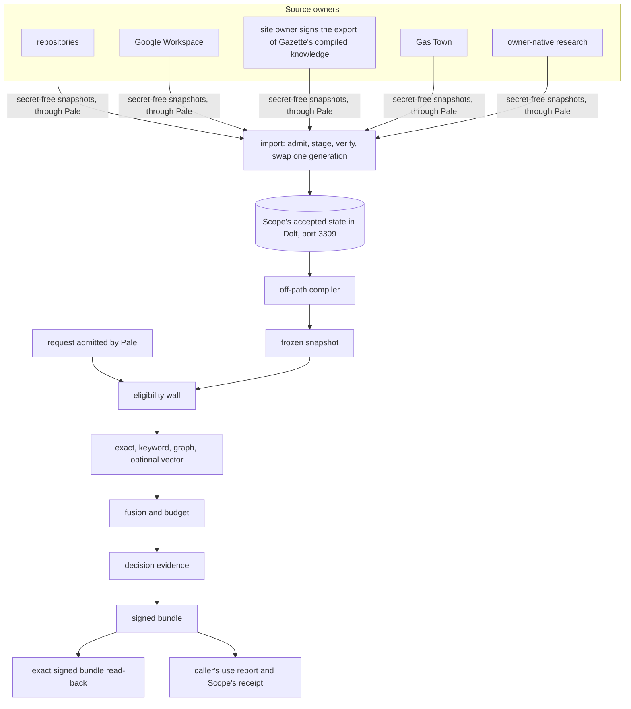

Scope's architecture separates acquiring source material, selecting context and recording its use\. Source owners supply secret\-free snapshots; Scope keeps the accepted projections in its own Dolt store and answers permitted requests with bounded bundles it signs itself\. Scope's design uses a Rust daemon\. The [developer introduction](/scope/overview) explains how this context lets a new session continue the work with its history and purpose intact\.

## What exists in code today {#what-exists-in-code-today}

The `scope` repository contains the Rust kernel crate, an empty library that the design's modules build into\. It builds without sibling checkouts\. The repository's [development guide](/scope/development) owns the build commands and layout, including the separate research paper\. [Contracts](/scope/engineering/contracts) identifies what must be published before consumers can integrate\.

## How the parts fit {#how-the-parts-fit}

The diagram shows the integrated import and retrieval path through Pale, outside an execution binding\.

An owner's helper reads its source with its own credentials and hands over a secret\-free snapshot\. Scope admits it and swaps the namespace to one new generation\. Away from live traffic the compiler freezes the accepted state, released policy and permission slice into one snapshot\. An admitted request pins that snapshot, passes eligibility and runs the permitted routes\. Scope fuses and trims the results to budget, records its decision and signs the bundle\.

Means performs calculations from owner\-held facts; the owner's workspace selects permitted inputs and retains the run records\. An owner\-selected reference or projection from those runs enters through that owner's snapshot contract, as [Contracts](/scope/engineering/contracts#who-may-consume-scope) explains\. Means keeps no store of its own for Scope to import\.

Resolving, reading and reporting use each have independent contracts\. An [execution\-bound handoff](/scope/engineering/episodes-and-use#an-episode-is-opened-before-resolve-and-bound-once-to-its-handoff) opens its episode before resolve and requires a separate binding to the execution owner's evidence\. That path waits on the episode issuer\. [Offline improvement](/scope/engineering/improvement-and-go-live) uses evidence admitted for the experiment and follows its own ruling and release gates\.

## Which page answers which question {#which-page-answers-which-question}

**How it is put together\.** [Architecture](/scope/engineering/architecture) holds the boundary, the three paths, the crates and modules, storage and transports\. [Data model](/scope/engineering/data-model) holds the graph, the item envelope and every table\. [Resources and locations](/scope/engineering/resources-and-locations) covers one file living in many places\.

**What it exchanges\.** [Contracts](/scope/engineering/contracts) covers publication, signing and the record families, [Record reference](/scope/engineering/record-reference) the available field sketches and remaining gaps, and [Admission and trust](/scope/engineering/admission-and-trust) who may call and whose snapshots count\. [Source imports](/scope/engineering/source-imports) explains how a snapshot becomes visible and what each source adapter accepts\.

**How it answers\.** [Retrieval](/scope/engineering/retrieval) covers the order of checks, the routes, the frozen snapshot and the falsifiers, and [Scoring](/scope/engineering/scoring) A\-MAC\-lite and telemetry\. [Episodes and use](/scope/engineering/episodes-and-use) covers exact bundle read\-back, reports of use and the deferred execution\-bound path\.

**How it stays honest\.** [Durability and recovery](/scope/engineering/durability-and-recovery) covers crashes, fences, the anti\-rollback anchor, startup and migrations\. [Improvement and go\-live](/scope/engineering/improvement-and-go-live) covers how anything may improve and the go\-live rehearsal\. [Evidence export and Reckon](/scope/engineering/evidence-export-and-reckon) covers research exports and Reckon's roles, [Diagnostics](/scope/engineering/diagnostics) the local diagnostic stream, and [Acceptance tests](/scope/engineering/acceptance-tests) everything that must be proved\.

**Where to contribute\.** [Development](/scope/development) connects each kind of change to its implementation home and checks\.

## How Scope meets its siblings {#how-scope-meets-its-siblings}

[Architecture](/scope/engineering/architecture) explains the integrated and standalone routes and their division of work\. [Contracts](/scope/engineering/contracts) specifies what each consumer may exchange; Counsel's memory host owns its independent permission and failure checks\. [Retrieval](/scope/engineering/retrieval) explains how Scope uses the host's artifacts\. [Improvement and go\-live](/scope/engineering/improvement-and-go-live) keeps the full rehearsal requirements, including Reckon's three roles and the memory\-host loss case\.

Part of [Scope](/scope/overview)\.
